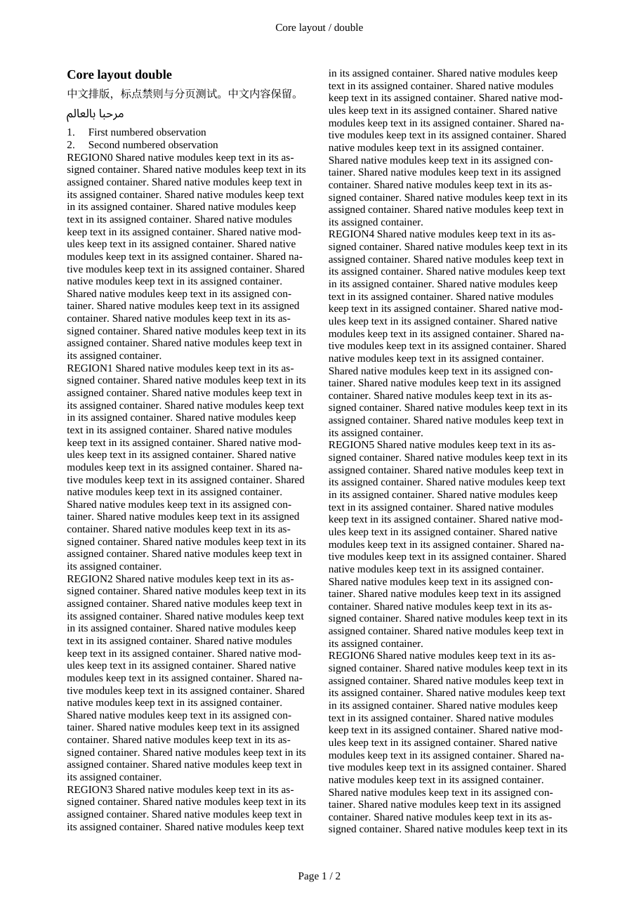
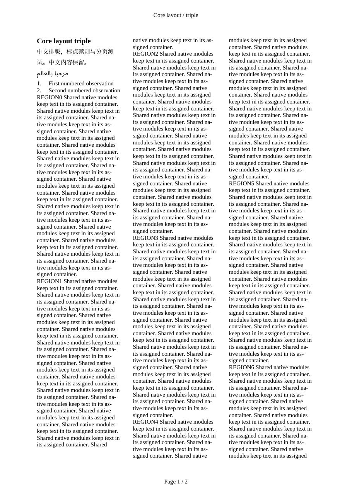
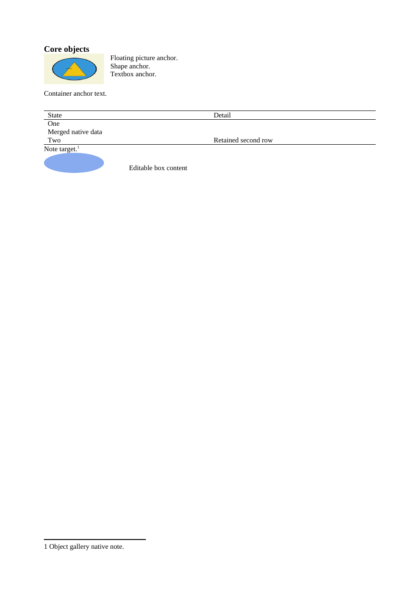
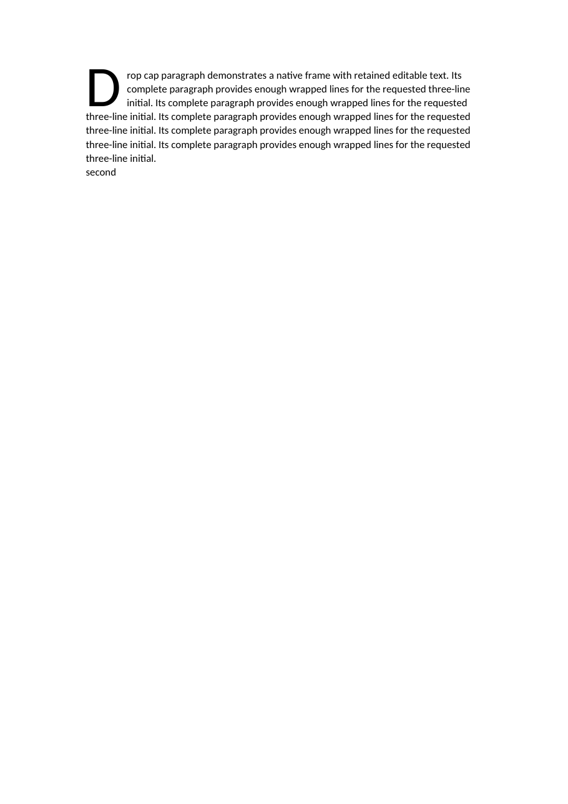
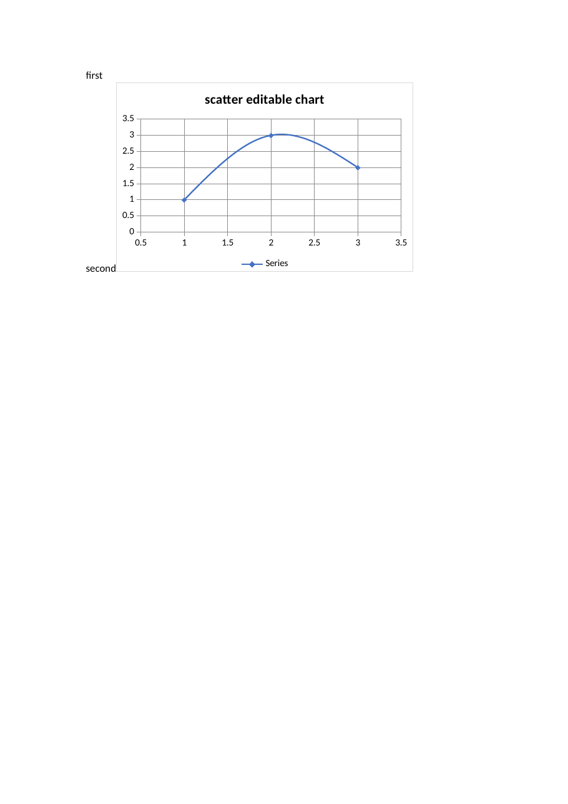
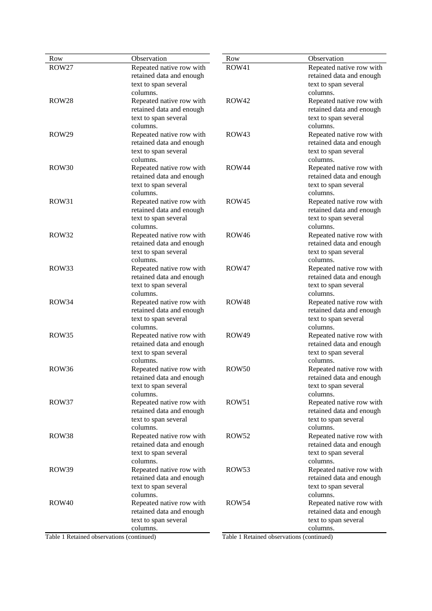

# Word Module Studio

**English** | [简体中文](README.zh-CN.md)

A standalone, general-purpose skill for creating, editing and checking **Word DOCX documents**. Use it through a Codex skill, explicit JSON tasks or a Python API. Ordinary edits and documents governed by a reusable template share the same engine.

Pinned OfficeCLI, Open XML SDK, Pandoc and LibreOffice provide the document backend. **Document operations, tests, conversion and rendering run in GitHub Actions.** Your local machine submits explicit files, checks task status and downloads results. No additional model API is required.

Use it for reports, manuals, proposals and other structured documents with editable text, equations, tables, charts and consistent layout. Application-specific content and business policies belong in the calling application.

[Download the skill](https://github.com/Self-Command/word-module-studio/releases/latest) · [Task examples](examples/README.md) · [Module contracts](docs/modules.md) · [Acceptance scope](docs/status.md)

## See the tested output

These are **unmodified page images from real generic regression documents**, rendered with LibreOffice 26.8.1 and reviewed page by page. They show the DOCX compatibility output; Microsoft Word desktop rendering has not been qualified. Click an image for its full-size page. The isolated samples intentionally leave unused page space.

| Two-column multilingual layout | Three-column layout |
| :---: | :---: |
| [](docs/gallery/two-columns.png) | [](docs/gallery/three-columns.png) |
| **Readable native equations** | **Preserved author alignment** |
| [](docs/gallery/editable-math.png) | [](docs/gallery/author-alignment.png) |
| **Floating objects and merged table** | **Native three-line drop cap** |
| [](docs/gallery/native-objects.png) | [](docs/gallery/drop-cap.png) |
| **Editable chart with workbook data** | **Continued table across columns** |
| [](docs/gallery/editable-chart.png) | [](docs/gallery/continued-table.png) |

All eight images have [source pages and SHA-256 fingerprints](docs/gallery/provenance.json) from [cloud run 38059546545](https://github.com/Self-Command/word-module-studio/actions/runs/38059546545). That layout baseline passed **100 regression tests, 26 generic proofs and all 49 pages of direct review**. The standalone 0.1.1 source passes **101 tests in all six suites** in [run 38064409279](https://github.com/Self-Command/word-module-studio/actions/runs/38064409279), including the publication inventory and exclusion of unlisted installation files. This is evidence for those scenarios, not every Word feature or arbitrary input.

## Features

| Module | Available operations |
| --- | --- |
| M01 · Documents and packages | Create/read/copy/save DOCX, object snapshots, relationships and untouched-part preservation. |
| M02 · Text and characters | Insert/delete/replace text, edits across runs, fonts and formatting, language and RTL properties. |
| M03 · Paragraphs and styles | Alignment, indentation, spacing, tabs, borders, style inheritance, effective formatting, pagination rules, native frames and drop caps. |
| M04 · Lists and numbering | Bullets, multilevel lists, heading numbering, restarts, continuation and start overrides. |
| M05 · Pages and sections | Size/orientation/margins, breaks, equal/unequal columns, line numbers, gutters and section ownership. |
| M06 · Headers, footers and pages | First/even/default variants, section links, page fields and numbering restarts. |
| M07 · Fields and references | Bookmarks, hyperlinks, native fields, independent figure/table/equation captions and cross-references. |
| M08 · Contents and indexes | TOC, caption indexes and index fields; refresh editable field results against actual pagination. |
| M09 · Native mathematics | Editable OMML from supported LaTeX; inline/display math, fractions/scripts/matrices/cases, numbering, author alignment and practical outer wrapping. |
| M10 · Tables | Row/cell edits, widths/heights, merging, borders/shading, repeated headers, fixed/AutoFit policies, three-line tables and continued captions. |
| M11 · Pictures | Insert/replace, inline/floating anchors, wrapping, positioning, proportional sizing, crop and alternative text. |
| M12 · Editable charts | Chart/series/axis properties and synchronized embedded workbook data; six types have end-to-end evidence. |
| M13 · Shapes and textboxes | Native shapes, connectors, textboxes, watermarks, grouping/rotation, text effects and diagram interfaces. |
| M14 · Footnotes and endnotes | Native notes, section numbering rules and footnote/endnote conversion. |
| M15 · Comments and revisions | Anchored ranges, replies/status, tracked changes and scoped accept/reject decisions; structural evidence. |
| M16 · Forms and content controls | Text/rich text/picture/date/check/list, XML binding, conditional/repeated filling and legacy form-field interfaces; structural evidence. |
| M17 · Merge and extract | DOCX composition/extraction, auxiliary parts, identifier remapping and explicit header/footer policies. |
| M18 · Metadata and accessibility | Document properties; heading, language, picture-alt and table-header checks. |
| M19 · Templates and fonts | Versioned templates, protected masters, themes, font inheritance, CJK rules, reusable layout configuration and actual font-file embedding. |
| M20 · Proof and verification | PDF/PNG proofs, structure/reference/font checks, content differences, container geometry and page-bound visual receipts. |

See [module conditions and errors](docs/modules.md), [feature evidence](docs/core-features.json) and [coverage](docs/module-coverage.json). An upstream interface does not certify every option. Column, bar, line, pie, area and scatter charts have scoped visual evidence; other types need qualification. Comments, revisions and controls have structural tests rather than certified interactive Word UI behavior.

## Install the skill

1. Download the ZIP from the [latest release](https://github.com/Self-Command/word-module-studio/releases/latest).
2. Extract its complete **`word-module-studio` folder** into `$CODEX_HOME/skills`, or `~/.codex/skills` when `CODEX_HOME` is unset. Keep `SKILL.md`, `references/`, `agents/` and `core/` together.
3. Confirm that the skill is available in your Codex session. Before upgrading, retain a verified copy of the previous folder; restore it to roll back.
4. Configure a task repository below. Installing the skill does not configure GitHub execution automatically.

The ZIP contains the runtime, schemas, task workflow, documentation and related gallery images. It excludes test fixtures, tests, user documents and application adapters. The exact approved files are declared in [publication-manifest.json](publication-manifest.json).

## Set up execution

You need **Python 3.12+**, **GitHub CLI (`gh`)**, permission to write task branches and dispatch Actions, and an initialized task repository with Actions enabled. You can choose a private repository. Word and document-processing dependencies do not need to be installed locally; the workflow installs pinned cloud dependencies.

1. Choose a task repository, such as `YOUR_NAME/word-tasks`, with a default branch and at least one commit.
2. Copy [.github/workflows/document-task.yml](.github/workflows/document-task.yml) to the same path on its default branch and commit it.
3. Run `gh auth login` if GitHub CLI is not authenticated.
4. Pin a full engine commit. Resolve the standalone release tag:

```powershell
$wordEngineCommit = gh api repos/Self-Command/word-module-studio/git/ref/tags/v0.1.1 --jq ".object.sha"
```

Retain the resulting 40-character SHA with the task; do not use a moving branch name. The installed transport is `core/src/word_module_studio/client.py`. In a source checkout, use `src/word_module_studio/client.py` instead.

## First task: inspect an existing DOCX

Create a local task folder **outside the skill/source repository**. Put `input.docx` and this `task.json` inside it:

```json
{
  "schema_version": 1,
  "stage": "inspect",
  "files": [{"path": "input.docx", "role": "document"}]
}
```

From the installed skill folder, submit using your manifest's full path:

```powershell
python core/src/word_module_studio/client.py submit --repo YOUR_NAME/word-tasks --manifest "PATH_TO_TASK/task.json" --engine-commit $wordEngineCommit
gh run list --repo YOUR_NAME/word-tasks --workflow document-task.yml --limit 5
```

Submission returns a `task_id` and status URL. Find the run titled `Word task TASK_ID`, then use its numeric run ID:

```powershell
python core/src/word_module_studio/client.py status --repo YOUR_NAME/word-tasks --run-id RUN_ID
python core/src/word_module_studio/client.py fetch --repo YOUR_NAME/word-tasks --run-id RUN_ID --dir outputs
```

The downloaded `task-report.json` contains `result.snapshot.sha256`, object IDs, capabilities and accessibility findings. Inspecting does not edit the original. Downloads are nested under their artifact folders.

## Edit the document

Copy the snapshot's file SHA-256 and actual target object ID into `batch.json`:

```json
{
  "schema_version": 1,
  "input_sha256": "SHA256_FROM_SNAPSHOT",
  "mode": "free_edit",
  "operations": [{
    "id": "update-title", "module": "M02", "action": "set",
    "target": "OBJECT_ID_FROM_SNAPSHOT",
    "props": {"text": "Updated document title"}
  }]
}
```

Submit through the same transport with this task manifest:

```json
{
  "schema_version": 1,
  "stage": "edit",
  "files": [
    {"path": "input.docx", "role": "document"},
    {"path": "batch.json", "role": "batch"}
  ]
}
```

The client fills missing file hashes before upload. Inspect again if the input changes. Batches operate atomically on a copy; invalid targets, unsupported properties and stale inputs fail with diagnostics. `locked_template` additionally protects registered physical rules.

An agent can invoke the installed skill directly:

```text
Use $word-module-studio to update the attached DOCX title and rebuild its contents.
Execute in my private YOUR_NAME/word-tasks repository. Preserve the current fonts,
inspect before editing, and return the DOCX, compatibility PDF and page-review report.
```

## Create a document or reusable template

Choose an explicit font scheme for a formal new document. The [generic configuration](examples/core-layout.json) combines themes, CJK/pagination rules, columns, AutoFit, font embedding and math policies. Its values are examples and can be changed to suit the user's document.

For a reusable template, run `template-build` → `template-probe` → page review and `visual-receipt` → `template-register`. Then use `compose` with Markdown, the registered manifest and unchanged DOCX master, plus explicitly listed data, images, bibliography or font resources. `font_scheme` must match the template. Candidate templates can be probed through the Python API inside Actions; a probe does not register them.

The [task guide](examples/README.md) explains input roles and the template lifecycle. [TemplateSpec](schemas/template-spec.schema.json) is the authoritative configuration. Inside Actions:

```python
from word_module_studio.templates import build
from word_module_studio.compose import compose
from word_module_studio.render import render

manifest = build(template_spec, "build/template")
compose("document.md", manifest, "build/document.docx", resources=["figure.png"], data=metadata)
render("build/document.docx", "build/proof")
```

Document APIs reject local execution. Only submit/status/fetch run locally.

## Outputs and review

Document-producing tasks return an editable DOCX, compatibility PDF, page PNGs and JSON reports. `inspect` returns a snapshot; `verify` returns structural checks; field refresh returns an updated copy and proof. Reports separately record construction, automatic checks, completed visual review and accepted delivery.

Review every page before accepting delivery. A `visual-receipt` binds the original run, PDF and page hashes to a reviewer, the 21-item checklist, page observations and findings. Unresolved findings keep delivery unaccepted. See the [review checklist](https://github.com/Self-Command/word-module-studio/blob/main/skills/word-module-studio/references/visual-review.md).

## Privacy and publication scope

This repository contains only the generic skill, engine, interfaces, workflows, generic Word regression inputs, evidence, examples and licenses. [Publication checks](ci/audit_publication.py) reject tracked files outside the reviewed inventory, verify README links and bind gallery images to accepted pages. Packaging copies explicit approved files rather than sweeping directories.

Document inputs go to **your chosen task repository**, not automatically to this source repository. Only manifest-listed files are uploaded. Tasks create branches and Actions artifacts are retained for 30 days. Task commits remain until you manage their retention; they are not automatically deleted. Choose repository visibility before uploading confidential documents. Custom fonts are installed in the ephemeral runner and require appropriate usage and redistribution rights.

## Limitations

- LibreOffice 26.8.1 is the qualified compatibility renderer. Word desktop rendering, exact Word pagination and printer-specific behavior are not certified.
- Native OMML, author alignment and nested structures are retained. This renderer ignores native operator-break markers; compatible long formulas use outer arrays. Small adjustments may be reported. Missing symbols, changed structure or severe clipping fail acceptance.
- Actual font files are embedded when requested and permitted. PDF font presence does not prove Word loads the embedded face.
- Safe preservation of existing SmartArt, OLE and unknown parts is not full authoring or interactive validation.
- Desktop UI automation, live collaboration, VBA execution, digital signatures, encryption, mail merge and Microsoft Editor/Copilot services are outside this workflow.

## License and development

Original code is **Apache-2.0**. Reused MIT helpers retain their licenses and provenance; dependencies keep their own licenses. See [LICENSE](LICENSE), [third-party notices](THIRD_PARTY_NOTICES.md) and [pins](pins.json).

All development tests and document conversion/rendering/validation run in GitHub Actions. Local work is source editing, Git/transport operations and inspecting downloaded artifacts. Generic Word fixtures belong in the source repository for qualification and are excluded from the installation ZIP. Review and update the explicit inventory before publishing new scope.
